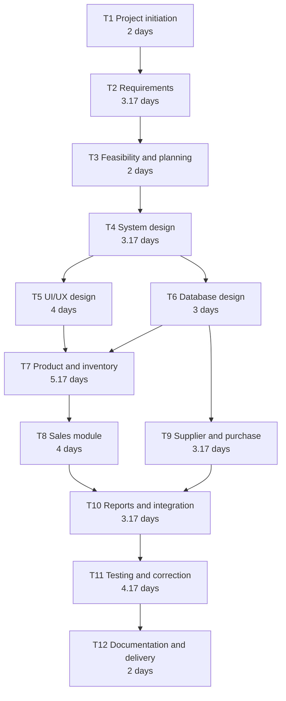
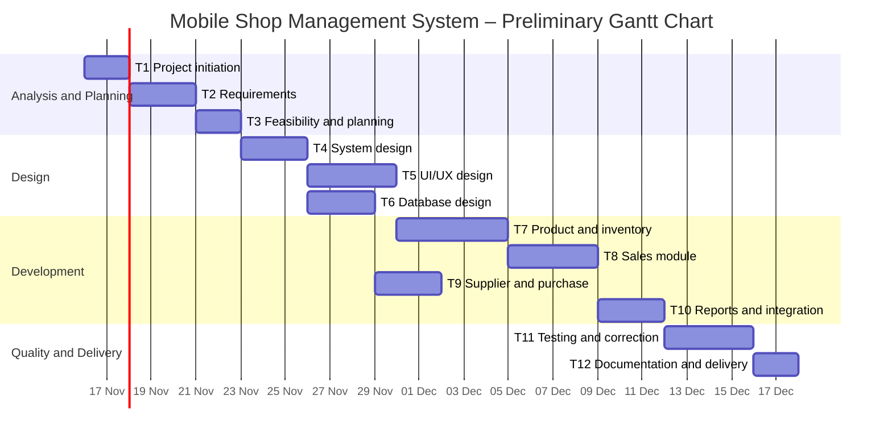

# Task 6 – PERT and Gantt Chart
## Mobile Shop Management System

### 1. Introduction
PERT (Program Evaluation and Review Technique) and Gantt charts are project-planning tools. PERT shows task dependencies and helps estimate the project duration, while a Gantt chart displays tasks across a timeline.

The estimates in this document are based on the task list in **Task 5 – Time Estimation and Task Identification**.

### 2. PERT Estimation
PERT uses three time estimates for each activity:

- **Optimistic (O):** The task duration if everything goes smoothly.
- **Most Likely (M):** The duration expected under normal conditions.
- **Pessimistic (P):** The duration if delays or difficulties occur.

The expected duration is calculated using:

**Expected Time (TE) = (O + 4M + P) / 6**

### 3. PERT Estimates

| ID | Task | O (days) | M (days) | P (days) | Expected time TE (days) |
|---|---|---:|---:|---:|---:|
| T1 | Project initiation | 1 | 2 | 3 | 2.00 |
| T2 | Current problem and requirements | 2 | 3 | 5 | 3.17 |
| T3 | Feasibility and project planning | 1 | 2 | 3 | 2.00 |
| T4 | System design | 2 | 3 | 5 | 3.17 |
| T5 | UI/UX design | 2 | 4 | 6 | 4.00 |
| T6 | Database design | 2 | 3 | 4 | 3.00 |
| T7 | Product and inventory module | 3 | 5 | 8 | 5.17 |
| T8 | Sales module | 2 | 4 | 6 | 4.00 |
| T9 | Supplier and purchase module | 2 | 3 | 5 | 3.17 |
| T10 | Reports and integration | 2 | 3 | 5 | 3.17 |
| T11 | Testing and correction | 2 | 4 | 7 | 4.17 |
| T12 | Documentation and delivery | 1 | 2 | 3 | 2.00 |

### 4. Activity Dependencies
The planned dependencies are:

- T1 → T2 → T3 → T4
- T4 → T5 and T6 (parallel activities)
- T5 and T6 → T7
- T7 → T8
- T6 → T9
- T8 and T9 → T10
- T10 → T11 → T12

### 5. PERT Network Diagram

### 6. Critical Path and Expected Project Duration
Using the dependencies and expected PERT durations, the longest path is:

**T1 → T2 → T3 → T4 → T5 → T7 → T8 → T10 → T11 → T12**

Expected duration:

2 + 3.17 + 2 + 3.17 + 4 + 5.17 + 4 + 3.17 + 4.17 + 2  
= **32.85 working days (approximately 33 working days).**

T6 and T9 are parallel activities and, under the current estimates, do not extend the longest path beyond the sequence above.

### 7. Gantt Chart
The following chart shows a preliminary schedule in working days. Tasks that depend on the same completed activity may run in parallel.

**Schedule note:** The Gantt chart uses 16 November 2026 as an illustrative start date so the chart can display calendar dates. The actual start date should be aligned with the team's approved project schedule. The durations are working days.

### 8. PERT and Gantt Comparison

| PERT | Gantt Chart |
|---|---|
| Focuses on task relationships and dependencies | Focuses on tasks against calendar time |
| Uses optimistic, most likely, and pessimistic estimates | Usually displays planned start dates and durations |
| Helps identify the critical path | Helps monitor schedule progress |
| Useful when task duration is uncertain | Useful for communicating the project timetable |

### 9. Conclusion
PERT provides an estimated project duration and identifies the critical path, while the Gantt chart presents the work schedule visually. Together, they help the team plan activities, understand dependencies, and monitor progress. The charts are preliminary and should be updated when actual start dates and progress become available.
